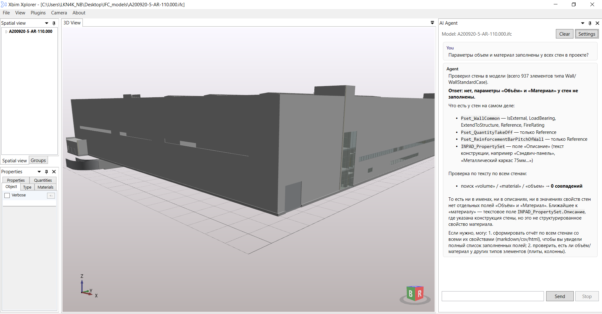

# XbimStudio

Приложение для просмотра и анализа IFC-моделей (BIM) на базе [XBIM Toolkit](https://github.com/xBimTeam). Решение построено на .NET Framework 4.7.2 (WPF/WinForms).

## Структура решения

Файл решения: `Xbim.WindowsUI.sln`

| Проект | Назначение |
|---|---|
| **Xbim.Presentation** | Библиотека WPF/WinForms-контролов для отображения IFC-моделей (публикуется как NuGet-пакет `Xbim.WindowsUI`) |
| **XbimXplorer** | Основное WPF-приложение — полнофункциональный просмотрщик IFC с 3D-визуализацией, деревом модели, плагинами |
| **XplorerPlugin.Bcf** | Плагин для обмена данными BCF (BIM Collaboration Format) |
| **XplorerPlugin.AiAgent** | AI-агент: чат с LLM для анализа открытой IFC-модели (OpenAI-совместимые API) |
| **Xbim.WinformsSample** | Пример интеграции контролов Xbim в приложение Windows Forms |
| **Tests** | Юнит-тесты Xbim.Presentation (MSTest) |

## Ключевые каталоги

### Xbim.Presentation — библиотека контролов
- `DrawingControl3D.xaml` — основной 3D-контрол для визуализации геометрии IFC
- `IfcMetaDataControl.xaml` — отображение метаданных и свойств объектов
- `FederatedModel/` — работа с федеративными (объединёнными) моделями
- `LayerStyling/` — стратегии окраски и стилизации слоёв модели
- `ModelGeomInfo/` — информация о геометрии модели
- `Overlay/` — оверлейные элементы поверх 3D-сцены
- `XplorerPluginSystem/` — система плагинов для расширения функциональности

### XbimXplorer — приложение-просмотрщик
- `XplorerMainWindow.xaml` — главное окно (AvalonDock-докинг)
- `Commands/` — панель команд (ветка дерева модели, поиск, экспорт)
- `Dialogs/` — диалоговые окна
- `PluginSystem/` — загрузка и управление плагинами
- `LogViewer/` — просмотр логов
- `Simplify/` — упрощение геометрии для больших моделей

### XplorerPlugin.Bcf — BCF-плагин
- `UI/` — элементы управления BCF
- `Examples/` — примеры BCF
- `xsd/` — XSD-схемы BCF

### XplorerPlugin.AiAgent — AI-агент
Плагин добавляет в XbimXplorer окно чата с языковой моделью (OpenAI-совместимый API, по умолчанию `api.openai.com/v1`, модель `gpt-4o-mini`). Агент работает по циклу «вопрос → вызов инструментов → ответ»: LLM сама выбирает инструменты для работы с открытой IFC-моделью и подставляет их результаты в диалог.

- `Agent/` — цикл агента (`AgentRunner`), определение инструментов, системный промпт
- `Chat/` — окно чата, рендеринг Markdown, вложения
- `Llm/` — клиент OpenAI-совместимого API (стриминг, tool calls)
- `Tools/` — инструменты агента:
  - `get_model_summary` — сводка по модели (схема, проекты, этажи, счётчики типов элементов)
  - `get_spatial_structure` — пространственная иерархия (Project > Site > Building > Storey)
  - `query_entities` — выбор элементов по типу, имени, этажу (AND-фильтры)
  - `get_entity_details` — детали элемента со всеми значениями property sets
  - `find_elements_by_text`, `list_property_sets`, `select_element_in_view`
  - `generate_report` — генерация отчёта по запросу агента
- `Reports/` — построение и сохранение отчётов
- `Settings/` — настройки (endpoint, модель, температура, лимиты); API-ключ хранится с защитой DPAPI в `%LOCALAPPDATA%\XbimXplorer\ai-agent.settings.json`



## Сборка и запуск

```bash
# Восстановление пакетов и сборка (Release)
dotnet restore Xbim.WindowsUI.sln
msbuild Xbim.WindowsUI.sln /p:Configuration=Release /restore

# Запуск просмотрщика
Output\Release\net472\XbimXplorer.exe
```

Требуется Visual Studio 2022 (MSBuild) или .NET SDK с поддержкой net472.

## Зависимости

- **Xbim.Common / Xbim.Ifc / Xbim.Ifc2x3 / Xbim.Ifc4** 6.1.605 — ядро XBIM (IFC-модель)
- **Xbim.Geometry** 5.1.820 — геометрическое ядро (triangulation, boolean ops)
- **Xbim.IO.Esent / Xbim.IO.MemoryModel** — хранение моделей (Esent / memory)
- **HelixToolkit.Wpf** 2.27.3 — 3D-рендеринг WPF
- **AvalonDock** 2.0 — докинг-панели
- **Serilog** + Microsoft.Extensions.Logging — логирование

## Лицензия

CDDL-1.0 — см. [LICENCE.md](LICENCE.md)
